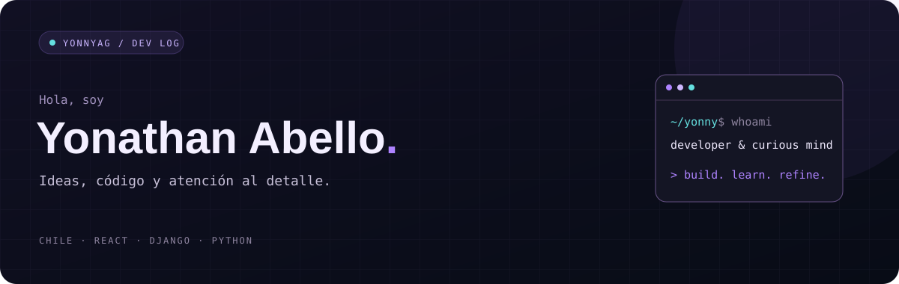

  

  
  

### Un poco de mí

Soy **Yonathan**, desarrollador de software desde Chile. Me interesa conectar interfaces con lógica de backend y explorar lo que se puede construir con **React, Django y Python**.

Este espacio reúne mis proyectos y experimentos: aplicaciones web, APIs y desafíos de lógica. Mi manera de avanzar es construir, entender lo que hago y seguir refinándolo.

### Proyectos en primer plano

<table>
<tr>
<td width="50%" valign="top">

#### 01 / Personal Analytics Dashboard

[Explorar el repositorio ↗](https://github.com/YonnyAg/Personal-Analytics-Dashboard)

`JavaScript` · `Dashboard`

</td>
<td width="50%" valign="top">

#### 02 / User Behavior Analysis API

[Explorar el repositorio ↗](https://github.com/YonnyAg/user-behavior-analysis-api)

`Python` · `API`

</td>
</tr>
<tr>
<td width="50%" valign="top">

#### 03 / Sudoku React

[Explorar el repositorio ↗](https://github.com/YonnyAg/Sudoku-React)

`JavaScript` · `React` · `Sudoku`

</td>
<td width="50%" valign="top">

#### 04 / TODO React

[Explorar el repositorio ↗](https://github.com/YonnyAg/TODO-React)

`JavaScript` · `React`

</td>
</tr>
</table>

### Mi caja de herramientas

  

<b>Detrás de los proyectos</b>

Mis repositorios combinan trabajo con interfaces, Python y práctica de programación. Aquí puedes recorrer tanto los proyectos como los ejercicios que forman parte de mi aprendizaje.

[Ver todos los repositorios →](https://github.com/YonnyAg?tab=repositories)

 

