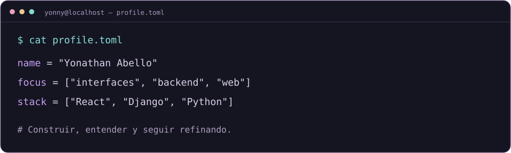
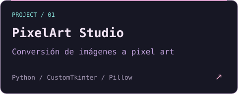
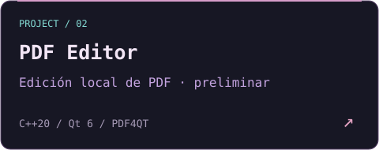
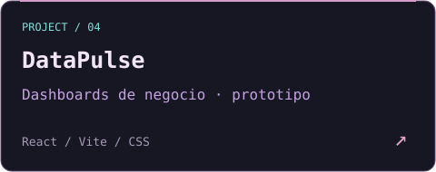

## `$ whoami`

Desarrollo **aplicaciones de escritorio y proyectos web** desde Chile. Me interesa crear herramientas útiles, trabajar con imágenes y documentos, y cuidar la experiencia de uso.

Actualmente mis proyectos combinan **Python, C++/Qt y React**: desde un editor de pixel art hasta un editor PDF local y experiencias web interactivas.

## `$ cat tech-stack.yaml`

<table>
<tr><td width="50%" valign="top">

`01 / escritorio`

`CustomTkinter · Pillow · Qt 6`

</td><td width="50%" valign="top">

`02 / web`

`Interfaces · componentes · dashboards`

</td></tr>
</table>

También exploro backend y APIs

Mi repositorio [User Behavior Analysis API](https://github.com/YonnyAg/user-behavior-analysis-api) contiene la base de una API con FastAPI y un endpoint de salud. El análisis de datos y las predicciones forman parte de su hoja de ruta.

## `$ ls projects/`

**[PixelArt Studio](https://github.com/YonnyAg/pixelart-studio)** — Conversión local de imágenes, comparación, presets e historial. [Microsoft Store](https://apps.microsoft.com/detail/9N18J6HDCHTS) · [Versiones para Windows](https://github.com/YonnyAg/pixelart-studio/releases).

**[PDF Editor](https://github.com/YonnyAg/PDF-Editor)** — Lectura, organización, anotación y edición de PDF, con OCR local. [Edición preliminar para Windows](https://github.com/YonnyAg/PDF-Editor/releases/tag/v0.1.0-preview.1).

**[Sudoku React](https://github.com/YonnyAg/Sudoku-React)** — Juego con generación de tableros, dificultades, notas, pistas y deshacer.

**[DataPulse](https://github.com/YonnyAg/Personal-Analytics-Dashboard)** — Prototipo de dashboards para ventas, clientes, inventario y reportes; utiliza datos demostrativos y tiene funciones en desarrollo.

---

<code>Construir con intención. Aprender con cada proyecto.</code> Desde Chile · @YonnyAg

