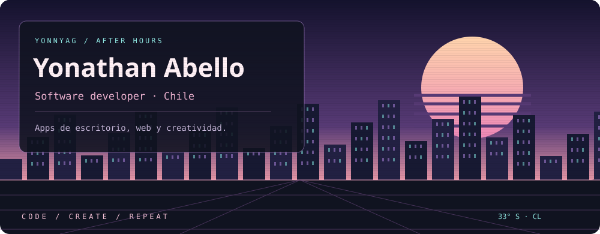
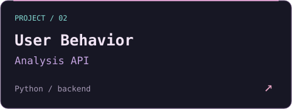
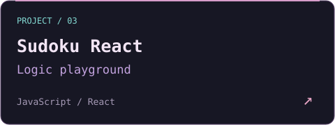
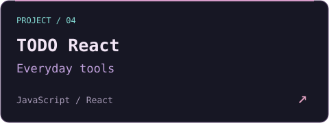

## `$ whoami`

## `$ cat tech-stack.yaml`

<table>
<tr><td width="50%" valign="top">

`01 / interfaces`

`React · JavaScript`

</td><td width="50%" valign="top">

`02 / backend`

`Python · Django`

</td></tr>
</table>

## `$ ls projects/`

---

<code>Construir con intención. Aprender con cada proyecto.</code> Desde Chile · @YonnyAg

